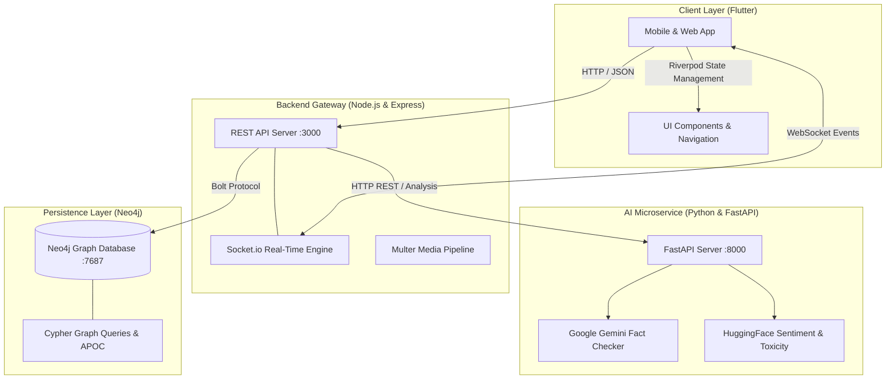
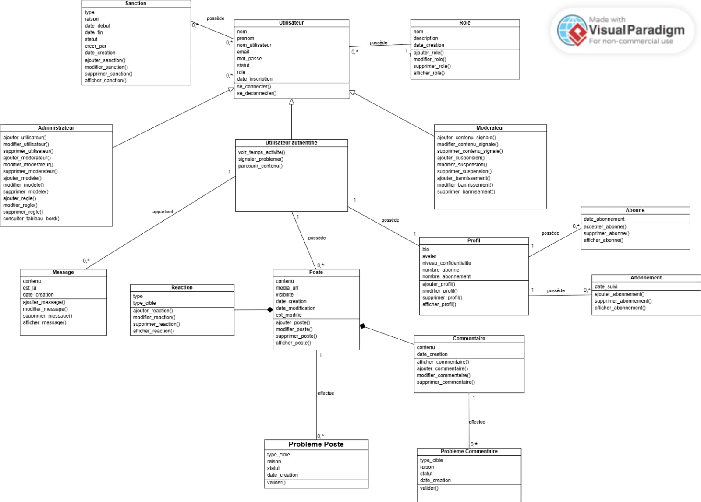
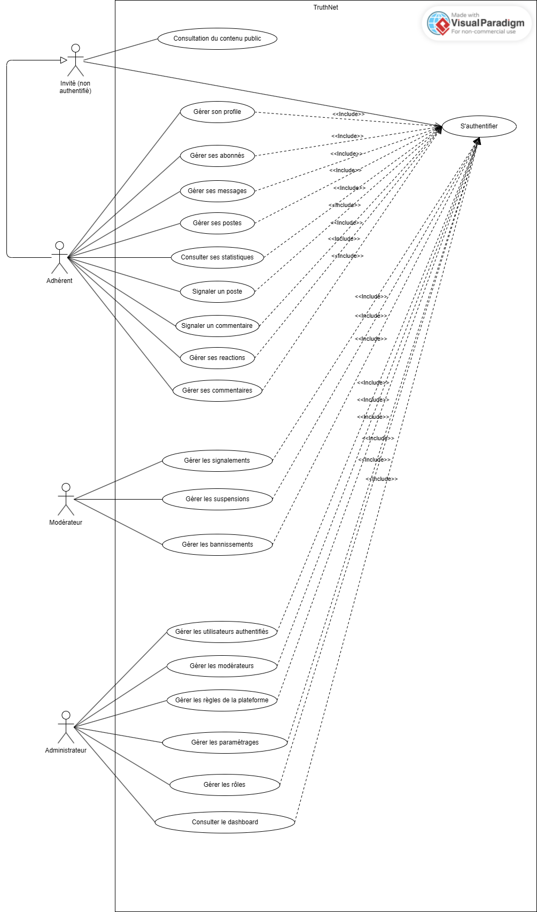

<div align="center">

# TruthNet - Intelligent Social Network & AI Fact-Checking Platform

**A full-stack, graph-powered social network built with Flutter, Node.js, Neo4j Graph Database, and a Python FastAPI AI microservice for automated fact-checking, sentiment analysis, and truthness scoring.**

[](https://github.com/trxshi747/TruthNet)
[](https://flutter.dev/)
[](https://dart.dev/)
[](https://nodejs.org/)
[](https://expressjs.com/)
[](https://neo4j.com/)
[](https://fastapi.tiangolo.com/)
[](https://ai.google.dev/)
[](https://socket.io/)
[](https://www.docker.com/)

<br />

<p align="center">
  <a href="#overview">Overview</a> |
  <a href="#key-features">Key Features</a> |
  <a href="#system-architecture">Architecture</a> |
  <a href="#graph-database-model-neo4j">Graph Model</a> |
  <a href="#ai--truthness-engine">AI Engine</a> |
  <a href="#tech-stack">Tech Stack</a> |
  <a href="#visuals-and-diagrams">Visuals</a> |
  <a href="#quick-start">Quick Start</a> |
  <a href="#api-reference">API Reference</a> |
  <a href="#repository-structure">Structure</a>
</p>

</div>

---

## Overview

**TruthNet** is a modern social media platform designed to combat online misinformation and enhance digital discourse. Unlike conventional social networks that rely solely on reactive moderation, TruthNet embeds automated **AI fact-checking**, **sentiment analysis**, and **toxicity classification** directly into the content lifecycle.

By coupling a **Neo4j Graph Database** with an asynchronous **Python NLP microservice (FastAPI + Google Gemini + HuggingFace Transformers)**, the platform models social interactions as deeply connected graph entities while evaluating content against contextual truthfulness metrics.

The client is crafted with **Flutter**, featuring custom **Neumorphic (Clay)** and **Glassmorphic** UI components, robust state management via **Riverpod & Freezed**, and live interactions powered by **Socket.io**.

---

## Key Features

### 1. Social Graph and Rich Interactions
* **Dynamic Media Feed:** Publish and explore posts containing text, multi-image galleries, and streaming video (Chewie/VideoPlayer).
* **Graph-Driven Social Loop:** Instant Likes, Unlikes, Shares, Bookmarks, and bidirectional Follow/Following relationships.
* **Threaded Comment Hierarchy:** Multi-level nested replies, comment likes, and live comment updates.
* **Real-Time Direct Messaging:** Instant private messaging between users backed by Socket.io web sockets.
* **Instant Notifications:** Live push alerts for likes, follows, comments, and moderation actions.

### 2. AI Fact-Checking and Truthness Engine
* **Contextual Fact Verification:** Evaluates post claims against Google Gemini generative models to detect false or unverified narratives.
* **Truthness Score Calculation:** Computes a composite reliability score (0-100%) based on linguistic patterns, factual consistency, and contextual correlation.
* **Sentiment and Toxicity Screening:** Offline/cached RoBERTa transformers classify community sentiment (positive, neutral, toxic) to preempt online harassment.
* **Automated and Threshold Moderation:** Flagged posts below admin-defined truthness thresholds trigger automatic warnings or moderator reviews.

### 3. Dual-Tier Administration and Moderation
* **Live Admin Analytics Dashboard:** High-performance visual metrics (posts per day, sentiment distribution, truthness distribution) with zero-refresh polling.
* **Moderator Action Hub:** Dedicated queues for reviewing reported posts and comments with AI pre-analysis.
* **Sanction Enforcement Lifecycle:** Graduated moderation pipeline (warnings, temporary suspensions, permanent bans) with full audit logging and revocation controls.
* **Dynamic Role-Based Access Control (RBAC):** Create, update, and assign fine-grained roles and permissions on the fly.

### 4. Neumorphic and Glassmorphic UI
* **Custom Design System:** Built-in ClayCard, ClayButton, GlassCard, and GlassButton widgets.
* **Dynamic Visual Flow:** Ambient animated background gradients, responsive media queries, and floating custom navigation.
* **Enterprise State Architecture:** Declarative reactivity using `flutter_riverpod`, immutable states generated by `freezed`, and structured DTO serialization.

---

## System Architecture



---

## Graph Database Model (Neo4j)

TruthNet leverages graph theory to represent social interactions without the relational bottlenecks of SQL JOINs:

| Node Label | Key Properties | Connected Via Relationship |
| :--- | :--- | :--- |
| `(:User)` | `id, username, email, password, isSuspended, isBanned` | `[:OWNS_POST]->`, `[:FOLLOWS]->`, `[:HAS_ROLE]->` |
| `(:Profile)` | `fullName, bio, avatar, location, website` | `(:User)-[:HAS_PROFILE]->(:Profile)` |
| `(:Post)` | `id, content, media, truthnessScore, createdAt, isDeleted` | `(:User)-[:LIKES_POST]->(:Post)`, `(:Post)-[:CONTAINS_COMMENT]->(:Comment)` |
| `(:Comment)` | `id, content, sentiment, toxicity, createdAt` | `(:Comment)-[:REPLY_TO]->(:Comment)`, `(:User)-[:LIKES_COMMENT]->` |
| `(:Role)` | `id, name, permissions` | `(:User)-[:HAS_ROLE]->(:Role)` |
| `(:Report)` | `id, reason, status, aiAnalysis, createdAt` | `(:User)-[:REPORTED]->(:Report)`, `(:Report)-[:TARGETS_POST]->` |
| `(:Notification)`| `id, type, text, isRead, createdAt` | `(:Notification)-[:NOTIFIES]->(:User)` |

---

## AI & Truthness Engine

The AI subsystem operates as an asynchronous microservice built on **FastAPI**:

* `/analyze/comment` - RoBERTa transformer toxicity and sentiment pipeline
* `/verify` - Google Gemini multi-source fact-checking
* `/dashboard-sentiment` - Aggregated sentiment metrics for administration
* `/health` - Service liveness and GPU/CPU fallback monitor

* **Warm-up on Startup:** ML pipelines are pre-cached in memory using `@lru_cache` to eliminate inference latency during live user requests.
* **Resource Optimization:** Configured with CPU fallbacks and memory limits, making it smooth to run in development and containerized environments.

---

## Tech Stack

| Layer | Technologies |
| :--- | :--- |
| **Mobile & Web UI** | Flutter 3.x, Dart 3.x, Flutter Riverpod, Freezed, Chewie, FL Chart, Google Fonts |
| **Backend API** | Node.js (v20+), Express.js, Socket.io, Multer, Bcrypt.js, Dotenv |
| **Graph Database** | Neo4j 5.x (Cypher, Bolt Driver, APOC Library) |
| **AI Microservice** | Python 3.11+, FastAPI, Uvicorn, HuggingFace Transformers, Google Generative AI (Gemini) |
| **DevOps & Containers** | Docker, Docker Compose, Multi-stage builds |

---

## Visuals and Diagrams

<div align="center">

| System Architecture & Classes | Use Case Flows | Mobile Interface |
| :---: | :---: | :---: |
|  |  |  |

</div>

---

## Quick Start

### Prerequisites
* Docker & Docker Compose (recommended), OR:
* Node.js 20+ & npm
* Python 3.10+ & pip
* Flutter SDK 3.x
* Neo4j Desktop / Server

---

### Option 1: Docker Compose (All-in-One Backend)

1. **Clone the repository:**
   ```bash
   git clone https://github.com/trxshi747/TruthNet.git
   cd TruthNet
   ```

2. **Configure environment variables:**
   ```bash
   cp backend/.env.example backend/.env
   cp ai_service/.env.example ai_service/.env
   ```
   *(Add your `GEMINI_API_KEY` in `ai_service/.env`)*

3. **Launch all services:**
   ```bash
   docker compose up -d
   ```
   * Neo4j Browser: `http://localhost:7474` (Credentials: `neo4j` / `truthnet123`)
   * Backend API: `http://localhost:3000`
   * AI Service: `http://localhost:8000/docs`

---

### Option 2: Manual Local Setup

#### 1. Neo4j Database
* Start your local Neo4j instance on `bolt://localhost:7687`.
* Set your password (e.g. `truthnet123`).

#### 2. AI Microservice (Python)
```bash
cd ai_service
python -m venv venv
# On Windows:
venv\Scripts\activate
# On Linux/macOS:
source venv/bin/activate

pip install -r requirements.txt
cp .env.example .env
python main.py
```
*AI service running on `http://localhost:8000`.*

#### 3. Backend Gateway (Node.js)
```bash
cd ../backend
npm install
cp .env.example .env
npm run init:admin    # Seeds initial Admin role and account
npm run dev           # Starts with nodemon
```
*Backend API running on `http://localhost:3000`.*

#### 4. Frontend Application (Flutter)
```bash
cd ..
flutter pub get
flutter run
```

---

## API Reference

### Authentication & Users
| Method | Endpoint | Description |
| :--- | :--- | :--- |
| `POST` | `/api/auth/register` | Register new user account |
| `POST` | `/api/auth/login` | Authenticate user & return session |
| `GET` | `/api/users/:userId/profile` | Retrieve user profile & graph stats |
| `PUT` | `/api/users/:userId/profile` | Update profile information & avatar |
| `POST` | `/api/users/follow` | Follow or unfollow another user |

### Feed & Posts
| Method | Endpoint | Description |
| :--- | :--- | :--- |
| `GET` | `/api/feed` | Retrieve global/personalized graph feed |
| `POST` | `/api/posts` | Create a new post with optional media |
| `POST` | `/api/posts/like` | Toggle like on a post |
| `POST` | `/api/posts/comment` | Add threaded comment to a post |
| `POST` | `/api/comments/:id/reply`| Reply to an existing comment |

### Administration & AI Verification
| Method | Endpoint | Description |
| :--- | :--- | :--- |
| `GET` | `/api/admin/dashboard` | Aggregated analytics & platform metrics |
| `PUT` | `/api/admin/users/:id/suspend` | Suspend user account with duration |
| `POST` | `/api/reports` | Submit post or user report |
| `POST` | `/api/ai/verify` | Trigger Gemini fact-check for content |
| `POST` | `/api/ai/analyze/comment` | Run RoBERTa sentiment & toxicity check |

---

## Repository Structure

```
TruthNet/
|-- ai_service/               # Python FastAPI Microservice
|   |-- models/               # Gemini fact-checking, sentiment, toxicity models
|   |-- routes/               # API routers (/analyze, etc.)
|   |-- Dockerfile            # Container configuration for AI engine
|   |-- main.py               # Application entry point & model caching
|   \-- requirements.txt      # Python dependencies
|
|-- backend/                  # Node.js & Express REST Gateway
|   |-- seeds/                # Cypher seed scripts for Neo4j
|   |-- Dockerfile            # Backend container configuration
|   |-- index.js              # Server entry point, Socket.io, & Neo4j routes
|   |-- initAdmin.js          # Admin bootstrap script
|   \-- package.json          # Node dependencies & scripts
|
|-- lib/                      # Flutter Mobile & Web Client
|   |-- core/                 # App themes (Clay/Glass) & shared widgets
|   |-- features/             # Feature-based state architecture (auth, feed, profile)
|   |-- screens/              # Screens (Admin, Moderator, Chat, Feed, Settings)
|   |-- services/             # API client, WebSocket & dashboard services
|   |-- widgets/              # Reusable Neumorphic and Glassmorphic widgets
|   \-- main.dart             # Flutter app entry point
|
|-- docs/                     # Documentation Assets
|   |-- diagrams/             # Class and use-case diagrams
|   \-- screenshots/          # Application UI previews
|
|-- docker-compose.yml        # Orchestration for Neo4j + Backend + AI Service
|-- pubspec.yaml              # Flutter dependencies & configuration
|-- .gitignore                # Git ignore rules
\-- README.md                 # Project documentation
```

---

## Authors

Developed by:
* **[trxshi747 (Yassir Karrouti)](https://github.com/trxshi747)**
* **[Ayataaki (Aya Taki)](https://github.com/Ayataaki)**


